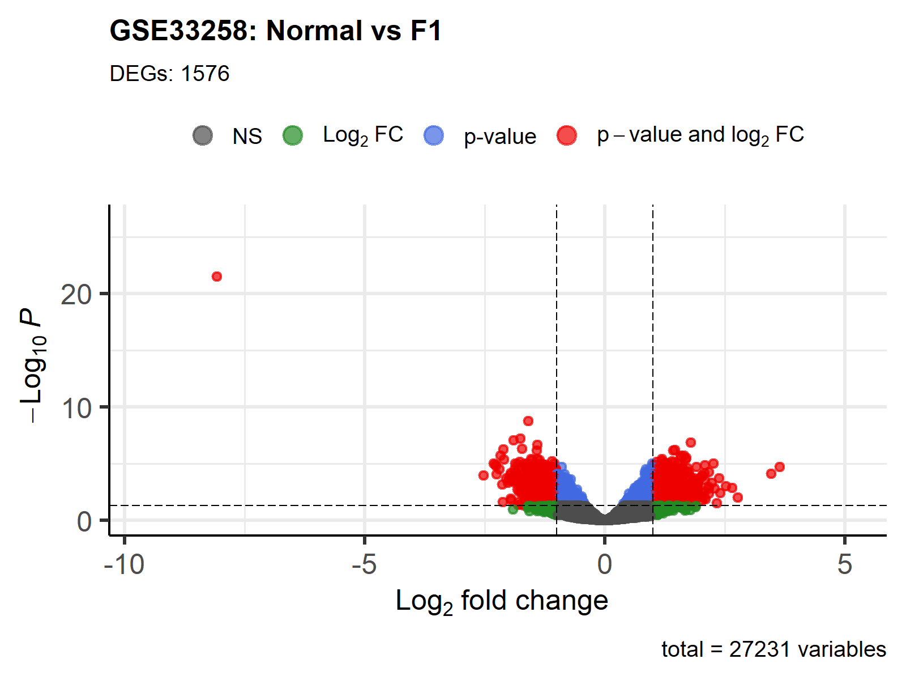
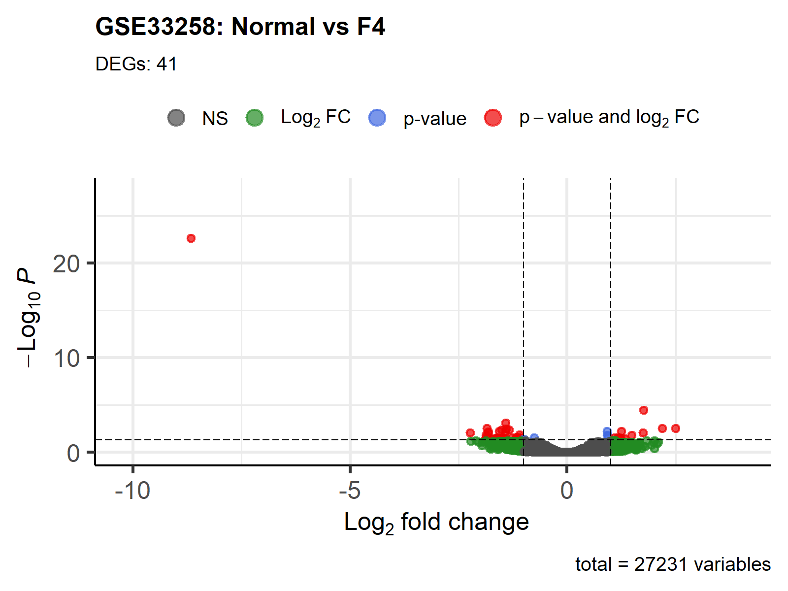
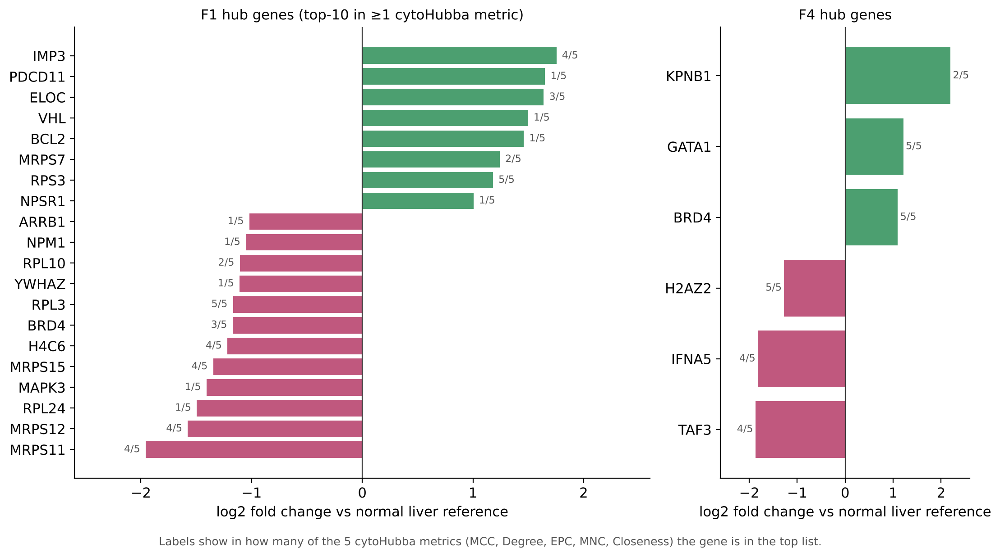

# Liver fibrosis transcriptomics: early stage vs cirrhosis (GSE33258)

Differential gene expression analysis of HCV-related liver fibrosis at **early (METAVIR F1)** and **cirrhotic (F4)** stages compared with normal liver, followed by **protein–protein interaction network analysis** to identify hub genes.

**Stack:** R · limma · GEOquery · EnhancedVolcano · STRING · Cytoscape (cytoHubba) · Python/matplotlib

📄 **Full report:** [report/REPORT.md](report/REPORT.md)

---

## Question

Which genes change in the liver at early fibrosis and at cirrhosis compared with normal tissue, and which of them sit at the centre of the protein interaction network?

## Data

[GEO GSE33258](https://www.ncbi.nlm.nih.gov/geo/query/acc.cgi?acc=GSE33258): liver biopsies from patients with chronic hepatitis C, two-colour microarray (GPL14795). Each array measures log2(sample / normal liver reference), so "Normal vs Fx" is tested as *mean log2-ratio ≠ 0*.

## Approach

```
GEO download ──► group samples by stage ──► limma (eBayes, BH FDR)
     │                                             │
     │                         adj. p < 0.05 & |log2FC| > 1
     ▼                                             ▼
probe annotation (GPL14795) ──► tables, volcano plots, Venn diagrams
                                                   │
                                                   ▼
                     STRING PPI network ──► Cytoscape / cytoHubba
                                            (MCC, Degree, EPC, MNC, Closeness)
```

## Results

| | Normal vs F1 | Normal vs F4 |
|---|---:|---:|
| Significant probes | **1,576** (745 ↑ / 831 ↓) | **41** (11 ↑ / 30 ↓) |
| PPI network | 657 proteins, 1,765 edges | 8 proteins, 5 edges |
| Top hubs | RPS3, RPL3, IMP3, MRPS11/12/15, H4C6, BRD4 | BRD4, GATA1, H2AZ2 |

- Early fibrosis and cirrhosis signatures barely overlap (0 shared up-regulated genes, 2 shared down-regulated).
- The F1 core is a **ribosomal / mitochondrial-ribosomal module**, mostly **down-regulated**.
- **BRD4**, a druggable epigenetic regulator of fibrosis, is a hub at both stages and changes direction: **↓ in F1, ↑ in F4**.

<p align="center">
  
  
</p>



Limitations (replicate structure, no direct F1-vs-F4 contrast, no enrichment analysis) are discussed in the [report](report/REPORT.md#5-limitations).

## Repository structure

```
├── R/limma_analysis.R          # full DE pipeline: download → limma → tables & plots
├── results/
│   ├── tables/                 # DE results (all probes for F4, significant genes for F1/F4), hub-gene log2FC
│   └── figures/                # volcano plots, Venn diagrams, hub-gene chart
├── network/
│   ├── string/                 # STRING exports (interactions + ID mapping) for F1 and F4
│   └── cytohubba/              # cytoHubba rankings per metric (csv + png) and hub overlap tables
└── report/REPORT.md            # full write-up (EN)
```

## How to run

```r
# R >= 4.2; the script installs missing Bioconductor packages
source("R/limma_analysis.R")
```

Outputs are written to `results_GSE33258/`. The full F1 results table (`DE_Normal_vs_F1_all.csv`) is not stored in the repo; the script regenerates it. The STRING and Cytoscape steps are manual (see the report, section 7).

## About

Course project for *Project Practicum*, Ural Federal University (2026), done as a team of two. My work covered the full pipeline: data processing and limma analysis, annotation, visualisation, network analysis and interpretation. The English report and repository were prepared afterwards.

**Kirill Ryabkov** · [GitHub](https://github.com/KiriLLLL17) · kirillryabkov17@gmail.com
