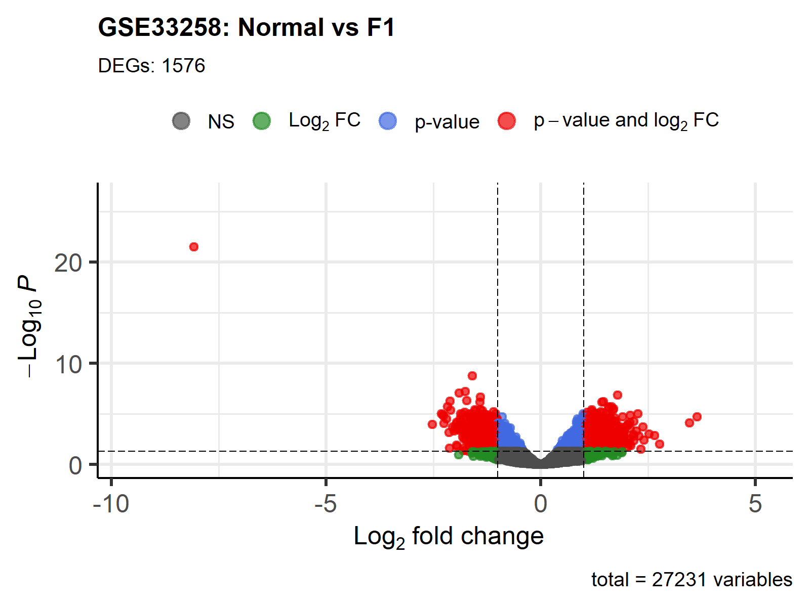
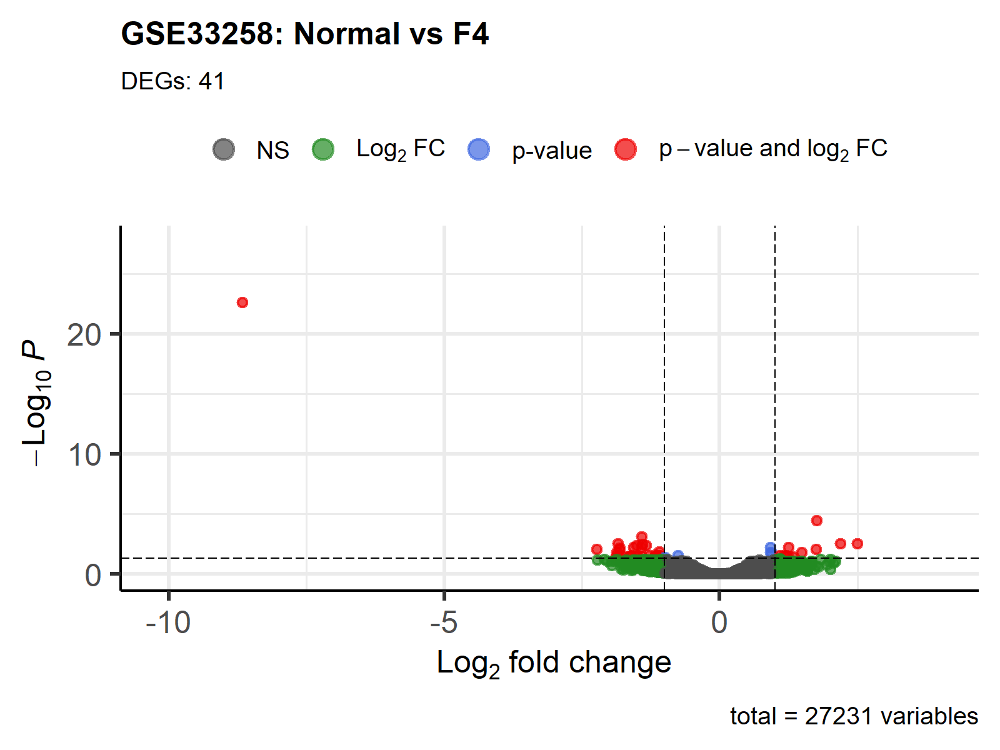
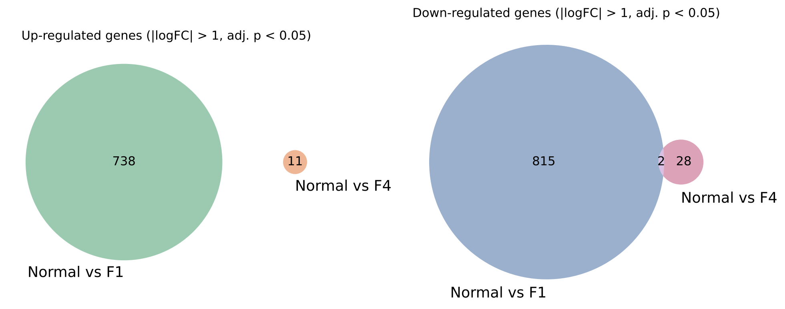
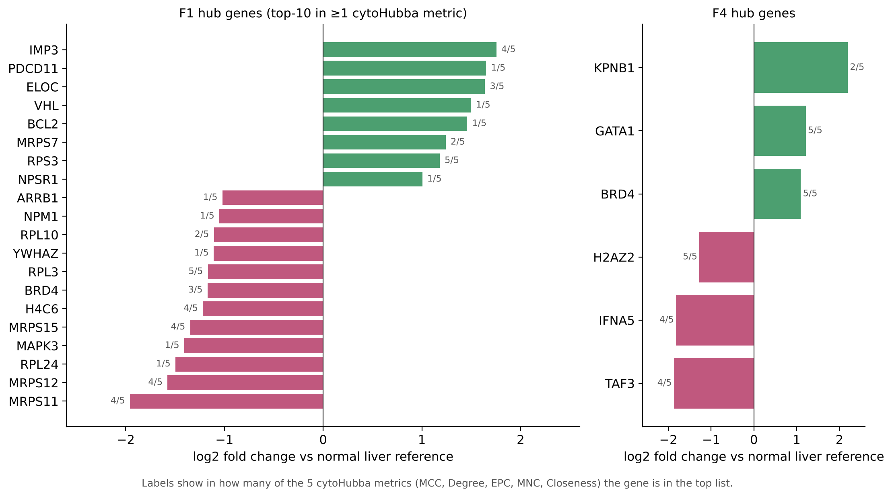

# Transcriptomic changes in early vs. advanced HCV-related liver fibrosis (GEO GSE33258)

**Author:** Kirill Ryabkov · Ural Federal University (UrFU), Project Practicum, 2026
**Tools:** R (GEOquery, limma, EnhancedVolcano, VennDiagram), STRING, Cytoscape + cytoHubba, Python (summary figures)

---

## Summary

Chronic hepatitis C (HCV) infection is a major cause of liver fibrosis, which can progress to cirrhosis and hepatocellular carcinoma. Using the public microarray dataset **GSE33258**, I compared gene expression in liver biopsies at an early fibrosis stage (**METAVIR F1**) and at cirrhosis (**F4**) against a normal-liver reference, then mapped the significant genes onto a protein–protein interaction (PPI) network to find hub genes.

Key results:

- **1,576 significant probes in F1** (745 up, 831 down) vs. **only 41 in F4** (11 up, 30 down); thresholds: BH-adjusted p < 0.05 and |log2FC| > 1.
- The two signatures are almost disjoint: **0 shared up-regulated genes** and **2 shared down-regulated** (one of them is an unannotated probe).
- In the F1 network (657 proteins, 1,765 interactions), the most central genes form a dense **ribosomal / mitochondrial-ribosomal module** (RPS3, RPL3, MRPS11/12/15) together with **IMP3**, **histone H4 (H4C6)** and **BRD4**. Most of these hubs are **down-regulated**.
- In F4 the network is tiny (8 proteins, 5 interactions); **BRD4** is the only node with more than one connection.
- **BRD4** is a hub at both stages but changes direction: **down in F1 (log2FC −1.17), up in F4 (+1.10)**.

---

## 1. Data

| Item | Value |
|---|---|
| Dataset | [GSE33258](https://www.ncbi.nlm.nih.gov/geo/query/acc.cgi?acc=GSE33258) — *Gene expression profiling in HCV associated liver disease* (Homo sapiens) |
| Platform | GPL14795, two-colour cDNA microarray |
| Samples | Liver biopsies of HCV (genotype 3a) patients, METAVIR stages F1–F4; 36 arrays were assigned to stages by the script (9 per stage) |
| Measurement | log2(Cy5/Cy3) ratio per probe; **Cy3 = reference normal human liver**; 27,231 probes |
| Original study | Ijaz B. et al., *Genes & Diseases*, 2019 |

Because every array is a ratio against normal liver, there is no separate "Normal" column group. A comparison "**Normal vs Fx**" is therefore tested as *"is the mean log2-ratio in stage Fx different from 0?"*

## 2. Methods

1. **Download & grouping.** The series matrix was downloaded with `GEOquery`; samples were assigned to F1–F4 by regular expressions on the sample title / source fields.
2. **Differential expression.** `limma`: linear model without intercept (`~0 + group`), so each coefficient is the mean log2-ratio of one stage; empirical Bayes moderation (`eBayes`); Benjamini–Hochberg FDR correction.
3. **Significance thresholds:** adjusted p < 0.05 **and** |log2FC| > 1.
4. **Annotation.** Probes were mapped to gene symbols with the GPL14795 annotation table; unannotated probes keep their probe ID.
5. **Visualisation.** Volcano plots (`EnhancedVolcano`) and Venn diagrams of up-/down-regulated genes.
6. **PPI network.** The significant gene lists were uploaded to **STRING** (Homo sapiens); the interaction networks were imported into **Cytoscape**.
7. **Hub genes.** The **cytoHubba** plugin ranked nodes with five centrality metrics — MCC, Degree, EPC, MNC and Closeness (top 10 for F1, top 5 for F4). Genes appearing in several metrics are considered the most robust hubs.

Code: [`R/limma_analysis.R`](../R/limma_analysis.R). STRING and Cytoscape steps were done interactively; their exports are in [`network/`](../network).

## 3. Results

### 3.1 Differentially expressed genes

| Comparison | Significant probes | Up | Down |
|---|---:|---:|---:|
| Normal vs F1 | 1,576 | 745 | 831 |
| Normal vs F4 | 41 | 11 | 30 |




The strongest signal in both comparisons is the unannotated probe **L4.ac27** (log2FC ≈ −8), far away from all other points. Such an extreme value for a single probe is typical of a control or artefact spot, so it should not be interpreted biologically.

Among annotated genes in F4, the largest changes are in **KPNB1** and **WRN** (up, log2FC ≈ +2.2 and +2.5) and **HSD11B2**, **DGAT1**, **TAF3** and **IFNA5** (down, log2FC ≈ −1.8 to −2.2).

### 3.2 Overlap between stages



The F1 and F4 signatures barely overlap: no shared up-regulated genes and two shared down-regulated ones (**IL22RA2** and the probe L4.ac27). Under this analysis, early fibrosis and cirrhosis show different transcriptional changes compared with normal liver, not a growing version of the same signature.

### 3.3 PPI network and hub genes

| | F1 network | F4 network |
|---|---:|---:|
| Proteins with ≥1 interaction | 657 | 8 |
| Interactions | 1,765 | 5 |

**F1.** The top-ranked genes overlap strongly between metrics. **RPS3** and **RPL3** are in the top 10 for all five metrics; **IMP3**, **MRPS11**, **MRPS12**, **MRPS15** and **H4C6** for four. Closeness additionally highlights signalling and apoptosis regulators (**NPM1**, **MAPK3**, **VHL**, **YWHAZ**, **BCL2**).

**F4.** **BRD4** (3 connections), **GATA1** and **H2AZ2** are in the top list for all five metrics. With only 8 connected proteins in three small components, centrality scores at this stage carry little information on their own.

The figure below shows the **direction** of each hub gene's change (bar) and in how many of the 5 metrics it was a top hub (label):



Per-metric rankings and the overlap tables: [`network/cytohubba/`](../network/cytohubba). Hub log2FC values: [`results/tables/hub_genes_F1_logFC.csv`](../results/tables/hub_genes_F1_logFC.csv), [`hub_genes_F4_logFC.csv`](../results/tables/hub_genes_F4_logFC.csv).

## 4. Interpretation

**Early fibrosis (F1).** The central module is made of cytosolic ribosomal proteins (RPL3, RPL10, RPL24, RPS3) and mitochondrial ribosomal proteins (MRPS7, MRPS11, MRPS12, MRPS15). Most of them are **down-regulated** (only RPS3 and MRPS7 go up). This points to reduced protein-synthesis and mitochondrial translation capacity rather than its activation, consistent with the mitochondrial dysfunction described in HCV-infected liver. Other notable hubs:

- **IMP3 (up)** — STRING mapped this symbol to the **U3 small nucleolar ribonucleoprotein IMP3**, which is needed for pre-18S rRNA processing (ribosome biogenesis); its neighbours (FBL, EXOSC1/2, RBM28) confirm this. It should not be confused with the oncofetal protein IGF2BP3, which is sometimes also called "IMP3".
- **Histone H4 (H4C6, down)** and **BRD4 (down)**: chromatin-related genes; BRD4 reads acetylated histones and regulates transcription, including pro-fibrotic programmes in hepatic stellate cells.
- **BCL2 (up)** and **VHL / ELOC (up)**: apoptosis control and the VHL–elongin complex that regulates hypoxia signalling (HIF).

**Cirrhosis (F4).** The small signature includes **BRD4 (up)**, **GATA1 (up)** and **KPNB1 (up)** (nuclear import), and down-regulation of **H2AZ2** (histone variant), **TAF3** (general transcription factor) and **IFNA5** (type I interferon). Lower interferon expression would be consistent with a weakened antiviral response in long-standing infection, but with 41 genes and 5 interactions this is a hypothesis, not a finding.

**BRD4** is the only gene that is a hub at both stages, and its sign flips (down in F1, up in F4). BRD4 is a known druggable regulator of liver fibrosis (BET inhibitors such as JQ1 reduce fibrosis in animal models), so it is the most interesting candidate for follow-up.

## 5. Limitations

- **Sample independence.** The dataset description lists three biological replicates per stage, while the script used 9 arrays per stage. If some arrays are technical replicates (or dye swaps) of the same biopsy, they are not independent, and the p-values are over-optimistic. Replicate structure should be modelled (e.g. `duplicateCorrelation` in limma), and any dye-swapped arrays should have their ratios flipped.
- **The F1 vs F4 asymmetry** (1,576 vs 41 genes) is unexpected biologically and may reflect higher variance in F4 or array-level effects rather than a weaker response in cirrhosis.
- **Comparison to a common reference** shows how each stage differs from normal liver; F1 and F4 were **not compared directly** with each other.
- **Gene-level summary:** several probes can map to the same gene (e.g. two histone H4 probes); they were not collapsed before network analysis.
- **Network step:** hub genes depend on STRING's confidence threshold and cover only the ~42% of F1 genes (657 of 1,576) that have known interactions. There is no experimental validation.
- No GO/KEGG enrichment analysis was performed.

## 6. Next steps

1. Check the sample/replicate structure on GEO and refit the model with replicate correlation and dye-swap correction.
2. Add a direct **F4 vs F1** contrast and the intermediate stages F2–F3 (e.g. a trend test across stages).
3. Run GO/KEGG enrichment (`clusterProfiler`) for the F1 up- and down-regulated sets.
4. Validate BRD4 and the ribosomal module in an independent HCV fibrosis dataset.

## 7. How to reproduce

```r
# R >= 4.2; installs Bioconductor packages on first run
source("R/limma_analysis.R")   # writes results_GSE33258/{tables,plots}
```

Then upload `DE_Normal_vs_F1_significant.csv` / `..._F4_significant.csv` gene lists to <https://string-db.org> (organism: Homo sapiens), export the network to Cytoscape and run cytoHubba.

## References

1. Ijaz B., Ahmad W., Das T., Shabbiri K., Husnain T., Hassan S. HCV infection causes cirrhosis in human by step-wise regulation of host genes involved in cellular functioning and defense during fibrosis: identification of bio-markers. *Genes & Diseases*, 2019.
2. Ritchie M. E. et al. limma powers differential expression analyses for RNA-sequencing and microarray studies. *Nucleic Acids Research*, 2015, 43(7): e47.
3. Davis S., Meltzer P. S. GEOquery: a bridge between the Gene Expression Omnibus (GEO) and BioConductor. *Bioinformatics*, 2007, 23(14): 1846–1847.
4. Szklarczyk D. et al. STRING v11: protein–protein association networks with increased coverage. *Nucleic Acids Research*, 2019, 47(D1): D607–D613.
5. Chin C. H. et al. cytoHubba: identifying hub objects and sub-networks from complex interactome. *BMC Systems Biology*, 2014, 8(Suppl 4): S11.
6. Shannon P. et al. Cytoscape: a software environment for integrated models of biomolecular interaction networks. *Genome Research*, 2003, 13(11): 2498–2504.
7. Bedossa P., Poynard T. An algorithm for the grading of activity in chronic hepatitis C. *Hepatology*, 1996, 24(2): 289–293.
